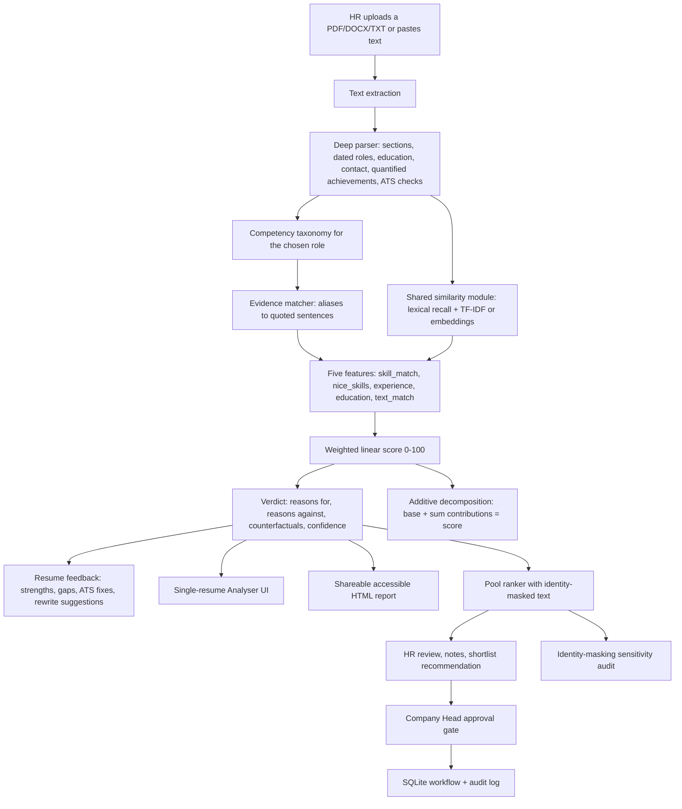

# FairHire architecture

## Layers

| Layer | Module | Responsibility |
|---|---|---|
| Knowledge | `fairhire/taxonomy.py` | Five role profiles: weighted core/preferred competencies, aliases, evidence hints |
| Extraction | `fairhire/data_loader.py`, `fairhire/skills.py` | Text extraction, skill vocabulary, years, education level, dated intervals |
| Reasoning | `fairhire/analyzer.py` | Parsing, evidence matching, scoring, verdict, counterfactuals, feedback |
| Similarity | `fairhire/similarity.py` | One blend used by both the Analyser and the Ranker |
| Ranking | `fairhire/ranker.py` | Pool scoring, additive contributions, rank order |
| Presentation | `main.py`, `fairhire/report.py` | Streamlit UI and the standalone HTML report |
| Governance | `fairhire/db.py`, `fairhire/fairness.py`, `fairhire/emailer.py` | Persistence, approval gate, audit log, sensitivity audit, draft emails |

## Design choices

- **Evidence before score.** A competency only counts when a real phrase from the resume supports it, and the phrase is quoted back to the reviewer. Keyword lists alone are not evidence.
- **One linear model, exactly explained.** Contributions are `weight × (value − pool mean) × 100`, so they sum to the score with no approximation. We do not call this SHAP.
- **No custom training loop.** The optional sentence encoder is inference-only. TF-IDF is always available as a fallback, and `FAIRHIRE_USE_EMBEDDINGS=0` forces it.
- **The Analyser and the Ranker agree.** Both call `text_similarity()`. Pool scores use identity-masked text, so a small, disclosed difference from the single-resume view is expected and is surfaced in the UI rather than hidden.
- **Human governance is enforced in the data layer.** Interview and Offer states require a recorded Company Head approval; email drafts are never sent automatically.
- **Fairness claims are bounded.** Identity-masking sensitivity is a diagnostic, not proof of demographic parity, fairness certification or legal compliance.
- **Accessibility is structural, not cosmetic.** Skip link, semantic landmarks, text alternatives for charts, keyboard focus outlines, and three user-controlled display modes.
